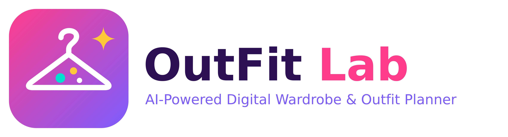

# OutFit Lab 👗
**AI-Powered Digital Wardrobe & Outfit Planner**

Course: 40722205 – Programming of Internet Applications · Amman Arab University
Student: Aziz Samara (202310961) · Phase 1 – Application Title and Requirements



OutFit Lab lets users organize their clothes, build outfits, save favorites and get outfit recommendations (rule-based first, external AI later).

## Tech stack
HTML5 · CSS3 · JavaScript · PHP · MySQL · **PDO** (no MySQLi)

## Planned pages
Home, Register, Login, Dashboard, My Wardrobe, Add Clothing, Outfit Builder, My Outfits, AI Suggestions, Profile.

## Database
Tables: `users`, `clothing_items`, `outfits`, `outfit_items` — see [`database/schema.sql`](database/schema.sql).

## Run locally (XAMPP)
1. Copy this folder to `htdocs/OutFit-Lab`.
2. Start Apache and MySQL, open phpMyAdmin and import `database/schema.sql`.
3. Edit `config/db.php` if your MySQL user/password differ.
4. Open http://localhost/OutFit-Lab/

## Project structure
```
config/     database connection (PDO)
database/   SQL schema
includes/   shared PHP (header, footer, helpers)
pages/      application pages
assets/     css, js, images
uploads/    clothing images
docs/       Phase 1 slides
```
